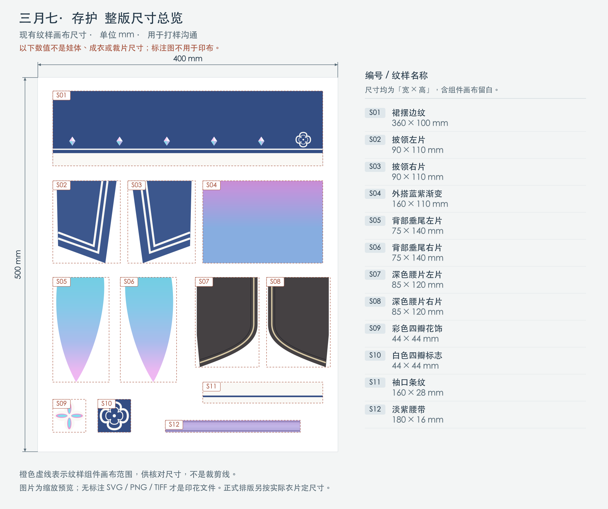
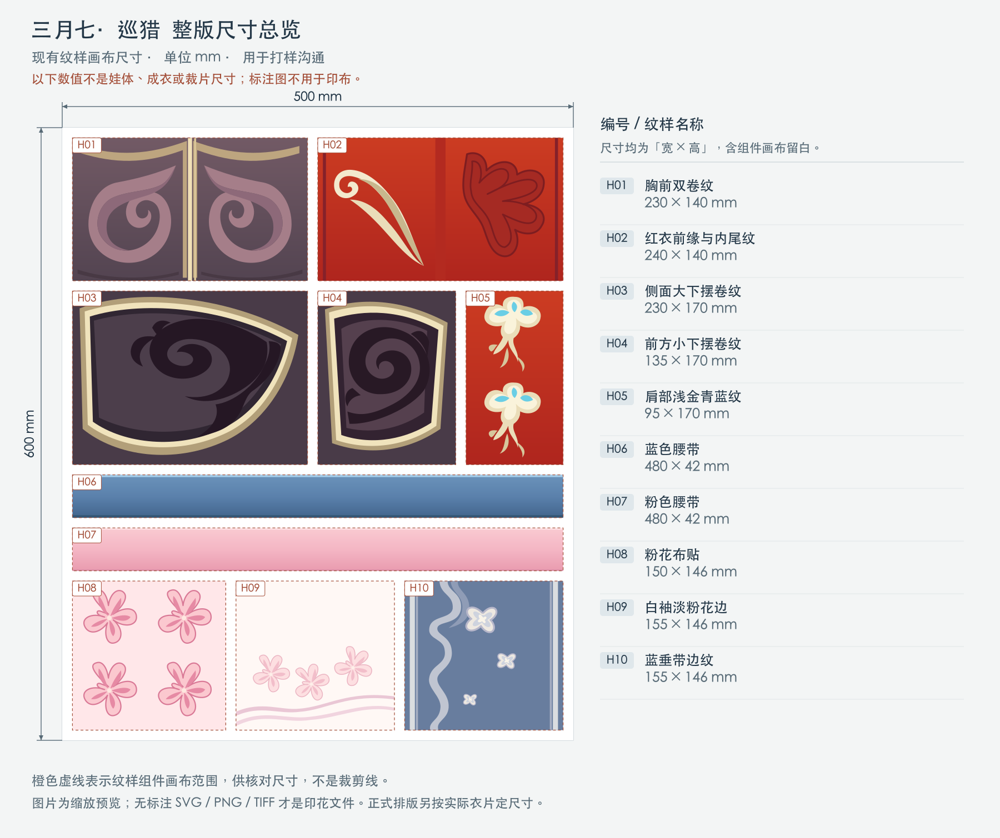

# 角色娃衣与配饰工坊

用于积累各类角色的娃衣布料印花、BJD／棉花娃娃服装、缠花与 3D 打印配饰。

**当前交付是照三月七公式服重绘的彩色布料印花稿，后续交给厂家印布。** 两套花型分别保存于 `fabric-print/`，包含配色、渐变、边饰和定位纹样。现有纸样属于历史辅助工作，不是本轮交付。

这是个人非商业制作项目。当前图稿是纹样打样布局，尚未按实际裁片定版，也未完成印布打样、缩水测量和成衣试穿。

## 先看尺寸图和选材

- [按部位选布、具体商品链接与国内询样入口](docs/fabric-selection.md)：裙片、披领、白袖、外搭与飘带分别取样，M1–M5 为主候选组。
- [拼接缝份与背部魔术贴规划](docs/seams-and-back-closure.md) · [彩色结构图](docs/illustrations/seams-and-back-closure-v0.1.png)：区分净衣片、缝份、搭接区与印花延伸；存护背部蝴蝶结确定为可拆别针款。
- 存护：[整版尺寸图](projects/honkai-star-rail/march-7th-preservation-bjd-1-4/fabric-print/dimensions-overview-v0.1.png) · [12 个分件尺寸图](projects/honkai-star-rail/march-7th-preservation-bjd-1-4/fabric-print/dimensions-components-v0.1.png) · [材料分组](projects/honkai-star-rail/march-7th-preservation-bjd-1-4/fabric-print/fabric-plan.json)。
- 巡猎：[整版尺寸图](projects/honkai-star-rail/march-7th-hunt-bandai-sitting-plush/fabric-print/dimensions-overview-v0.1.png) · [10 个分件尺寸图](projects/honkai-star-rail/march-7th-hunt-bandai-sitting-plush/fabric-print/dimensions-components-v0.1.png) · [材料分组](projects/honkai-star-rail/march-7th-hunt-bandai-sitting-plush/fabric-print/fabric-plan.json)。

尺寸图用 mm 标明现有纹样画布的宽、高，含组件自身留白；不是实际衣片尺码。带标注图片用于看稿与沟通，交厂印布选下列无标注文件，并在最终选布后按材质分别排版。

## 彩色印花文件

| 公式服与目标载体 | 纹样打样画布 | 文件入口 |
| --- | --- | --- |
| 三月七·存护／UFdoll 四分囡囡体 S 胸 | 400 × 500 mm | [印花文件目录](projects/honkai-star-rail/march-7th-preservation-bjd-1-4/fabric-print/) · [SVG 母版](projects/honkai-star-rail/march-7th-preservation-bjd-1-4/fabric-print/preservation-print-master-v0.1.svg) · [300 ppi PNG](projects/honkai-star-rail/march-7th-preservation-bjd-1-4/fabric-print/preservation-print-master-v0.1-300ppi.png) · [1:1 PDF](projects/honkai-star-rail/march-7th-preservation-bjd-1-4/fabric-print/preservation-print-master-v0.1-1to1.pdf) |
| 三月七·巡猎／万代一番赏 POTEPOTTE 坐姿三月七 | 500 × 600 mm | [印花文件目录](projects/honkai-star-rail/march-7th-hunt-bandai-sitting-plush/fabric-print/) · [SVG 母版](projects/honkai-star-rail/march-7th-hunt-bandai-sitting-plush/fabric-print/hunt-print-master-v0.1.svg) · [300 ppi PNG](projects/honkai-star-rail/march-7th-hunt-bandai-sitting-plush/fabric-print/hunt-print-master-v0.1-300ppi.png) · [1:1 PDF](projects/honkai-star-rail/march-7th-hunt-bandai-sitting-plush/fabric-print/hunt-print-master-v0.1-1to1.pdf) |

每套交付约定为可编辑 SVG、1:1 PDF、300 ppi sRGB PNG／TIFF；实际文件以各目录清单为准。**画布尺寸是本次纹样排版尺寸，不是衣服尺码，也不代表最终用布量。** 厂家交付、打样和颜色确认见[印花交付说明](docs/fabric-print-handoff.md)。

存护公式服尺寸总览：



巡猎公式服尺寸总览：



官方立绘、视频和游戏／MMD 模型用于核对图案、颜色、结构与位置。游戏 UV 贴图可以作为绘制依据，但不直接整图印成娃衣；定位花型最终需要映射到真实衣片，并计入缝合、折边和褶量。

## 项目与历史辅助资料

- [存护项目](projects/honkai-star-rail/march-7th-preservation-bjd-1-4/README.md)：囡囡体 S 胸；[基础试坯纸样](projects/honkai-star-rail/march-7th-preservation-bjd-1-4/patterns/README.md)保留用于后续适配，未经试穿。
- [巡猎项目](projects/honkai-star-rail/march-7th-hunt-bandai-sitting-plush/README.md)：坐姿棉花娃娃；[现成坐姿纸样调研](projects/honkai-star-rail/march-7th-hunt-bandai-sitting-plush/existing-pattern-research.md)和[额饰打印试件](projects/honkai-star-rail/march-7th-hunt-bandai-sitting-plush/models/README.md)保留，未经实物适配。
- [官方存护参考模型下载脚本](tools/download_preservation_reference.py)与[模型获取记录](docs/model-download-report.md)：下载到本地忽略目录，并保留来源与原始使用说明。

用户可以缝纫、制作缠花、购买材料，并拥有 3D 打印机。配饰后续按效果和安装方式选用缠花、打印或组合工艺。两个项目各自保存量体资料；“四分”、游戏角色比例与商品标称高度不能替代实测。

## 当前工作顺序

1. 对照官方公式服核对 `fabric-print/` 的颜色、纹样和部位对应，区分可见细节与待确认部分。
2. 选定布料和厂家，确认印花格式、色彩配置、实际尺寸与布纹方向；先印纹样和颜色小样。
3. 根据实际衣片确定定位花型的位置、方向、缝合余量及经纬向缩水补偿，再生成生产排版。
4. 完成印布、缝制和试穿后，将实物结果写入 `build-log.md`。数字文件检查不能替代实物验证。

## 目录

```text
docs/              通用流程、工具材料与参考资料管理
templates/         新角色／新娃体项目模板
projects/
  honkai-star-rail/
    <角色-造型-娃体>/
      README.md             当前目标、印花入口与进度
      measurements.md       娃体实测与穿脱条件
      references.md         来源、视角、模型及使用说明
      bill-of-materials.md  材料候选与实际消耗
      build-log.md          印花打样、改版、试装与成品验证
      fabric-print/         彩色印花母版、导出图、纹样对应与尺寸清单
      patterns/             历史辅助纸样及后续适配记录
      models/               自制配饰源文件、打印导出件和适配说明
```

新项目从[项目模板](templates/project-template.md)开始。材料选择见[工具与材料指南](docs/materials-and-tools.md)。

## 印花文件再生成

安装 Python 依赖与 Node 依赖后，在仓库根目录执行：

```sh
python3 tools/create_preservation_print.py
python3 tools/create_hunt_print.py
npm run export:fabric
python3 tools/verify_fabric_print.py
python3 tools/create_dimension_previews.py --render
python3 tools/create_seam_closure_preview.py --render
```

导出需要 Chromium／Chrome；可用 `PRINT_CHROME_PATH` 指定本机浏览器路径，或用 `npx playwright install chromium` 安装 Playwright 浏览器。导出文件使用 `-300ppi.png`、`-300ppi.tiff`、`-1to1.pdf` 后缀，预览图为 `preview-v0.1.png`。

尺寸标注另存为 `dimensions-*.svg/png`。中文会转换成文字轮廓；默认使用 macOS 黑体，其他系统可通过 `FABRIC_LABEL_FONT` 指定本地 CJK 字体路径、`FABRIC_LABEL_FONT_INDEX` 指定 TTC 字体索引。PNG 渲染使用 Node 与 sharp，可用 `FABRIC_NODE_BIN` 指定 Node 路径。

## 历史辅助文件再生成

使用 Python 3.9 或更新版本，安装 `requirements.txt` 后，在仓库根目录执行：

```sh
python3 tools/download_preservation_reference.py  # 下载并校验官方模型，存本地忽略目录
python3 tools/render_pmx_reference.py             # 用模型生成本地四视图参考
python3 tools/generate_patterns.py                # 根据参数重建试坯 PDF / SVG
python3 tools/generate_accessories.py --preview  # 重建额饰、底座与预览
```

以上命令用于参考模型、历史试坯与配饰文件；当前印花稿及其导出信息见各 `fabric-print/` 清单。

## 参考素材与公开文件

参考图、视频和官方模型的原始文件可保存在各项目的 `references/local/`，该目录默认不提交。公开仓库先记录来源链接、观察笔记和自主制作文件；官方模型发布页及使用说明需逐项核对，参考模型不直接视为可打印成品。

本仓库暂未设置统一开源许可证；第三方素材沿用其原始使用条件。详细记录方式见[参考资料管理](docs/references.md)。
