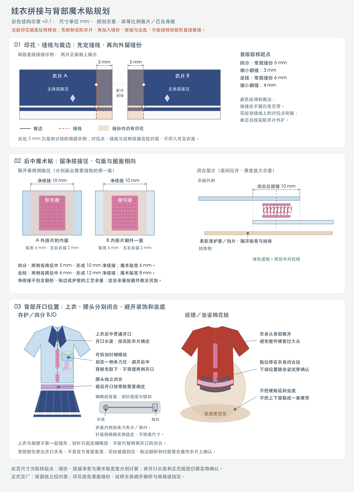

# 定位印花的拼接、缝份与后背开合

**版本说明：本页保留 v0.1 的结构约定。** 完整衣片已推进到 v0.2 数值试版，见[分层打版册](garment-guide.html)及两项目的 `garment-pattern/`。下文“尚缺完整衣片”指旧 `fabric-print/` 的纹样样块；新衣片可用于试坯，仍未实物试穿，也尚未与旧纹样合成最终定位印布稿。

两套衣服的印花都要按实际衣片的缝合关系重新定位，并在背部留独立开合区。存护背部蝴蝶结按用户确定的方案做成**可拆别针款**。

本页是后续印布文件的制作约束。现有 22 个文件是纹样/配色样块，其中包括重复试色、局部纹样和可选布贴；**不是 22 块能直接拼成衣服的裁片**。现有文件没有完整前后衣身，也没有经过娃体试穿的缝线，须先映射到实际衣片，再添加各边对应的工艺余量。

两项目的逐项记录见 [存护 sewing-plan.json](../projects/honkai-star-rail/march-7th-preservation-bjd-1-4/fabric-print/sewing-plan.json) 和 [巡猎 sewing-plan.json](../projects/honkai-star-rail/march-7th-hunt-bandai-sitting-plush/fabric-print/sewing-plan.json)。材料分组沿用 [布料方案](fabric-selection.md)。

图示为结构说明，不是 1:1 衣片；最终外形、开口长度和别针位置仍须由实际衣片确定。

## 1. 先固定这些试版起点

| 项目 | 四分囡囡体 S 胸·存护 | 万代坐姿棉花玩偶·巡猎 | 用法 |
|---|---:|---:|---|
| 普通拼接缝份 | 5 mm | 6 mm | 从**缝合线**量到裁剪线；肩、侧、袖窿、腰部等先用此值试版 |
| 小件薄翻缝缝份 | 3 mm | 4 mm | 垂带、薄布贴、细小面里翻缝先试；不自动替代所有接缝 |
| 勾/圈带成品宽 | 6 mm | 8 mm | 设计目标；还未确认某品牌有该窄宽现货 |
| 闭合后的总净搭接宽 | 10 mm | 12 mm | 是整处重叠的总宽，**不是左右两片各加 10 / 12 mm** |
| 粘扣带两侧净空 | 各 2 mm | 各 2 mm | 带在搭接区居中；由搭接边到带边量取，保留布边及车缝操作空间 |
| 每片超出原后中线的净延伸 | 各 5 mm | 各 6 mm | 两专门后片各向对侧延伸，闭合形成上面的总搭接宽 |
| 后边折回/另裁贴边的工艺余量 | 待定 | 待定 | **另计**；须选定贴边做法、布厚和薄衬后确定 |
| 后开口长度、勾圈各段长度 | 待真实衣片与试穿确定 | 待自然坐姿与穿脱路径确定 | 不从印花样块高度、玩偶标称身高或图片比例推算 |
| 下摆折边量、裁剪边外印刷出血 | 待工艺/厂家试样确定 | 待工艺/厂家试样确定 | 不等同于普通拼接缝份 |

这些数值是本项目的制作起点，未经过实物验证；布料滑移、散边、压线宽度和翻缝厚度都可能要求调整。2 mm 是居中排布的目标净空，不是厂家已承诺的印刷或车缝公差。若粘扣带实际宽度、缝针位置或局部衬需要更大空间，先修订搭接区再出印花文件。

## 2. 印花图怎样为缝合留空间

1. **先定成品边和缝合线。** 将前后、左右、袖口、腰头等实际衣片展开，明确哪条线与哪条线相接。曲线按缝线走缝核对；袖山吃势、裙褶收量单独记录，不能强行让所有裁剪边等长。
2. **再从各边增加对应工艺余量。** 普通拼接按上表起点；翻缝、折边、贴边、后开口分别指定。现有图案外轮廓、金边、白边和样块边框都不能直接当裁剪线。
3. **把底色/图案延伸进缝份，直至实际裁剪边。** 印色覆盖缝份能降低车缝偏移后露白的风险。装饰边纹应依据成品边定位，不随增加缝份整体外移。工厂布边上的未印白边不能代替所需的有色缝份。
4. **工艺线分层。** `PRINT_ART` 只导出图案、底色和有色缝份；`SEW_GUIDE` 标缝线、折线、拼接编号、对位记号、纹向；`CUT_GUIDE` 标裁剪轮廓和各边余量；`CLOSURE_GUIDE` 标后中、搭接、扣带及局部支承区。后三层用于校对/反面转印，不混进可见面印花。
5. **对花看闭合后的可见部分。** 相邻衣片共享缝线上的高度/坐标，在端点及必要转折标成对记号。白线、金边、渐变跨缝连续；主要花纹和标志不放到被后背搭接遮住的区内。各材质先分别打样，再按印后/洗后变形校正。

[Prinfab 的文件准备说明](https://prinfab.com/resources/faqs/)明确把裁切和卷边所需余量留在图稿中；本项目的 5 / 6 mm 不是该厂规定或行业统一数值。裁剪边外的额外出血和最终排料间距仍由具体厂家确认。

## 3. 后背粘扣带：专门后片、独立层次

必须新增穿衣者左后片、右后片及后边薄贴边/护里；现有纹样没有完整背衣身。后中合体参考线保留，左、右片各跨过此线净延伸 5 mm（四分）或 6 mm（坐娃），闭合后总重叠 10 mm / 12 mm。折边或另裁贴边的余量在这个净结构之外另加，不能一边加搭接一边又把它误算成衣服围度松量。

本版选穿衣者左侧为上层外搭、右侧为下层内搭；这是便于制作的方案选择，不声称官方服装采用相同开法。

| 位置 | 安装面 | 闭合关系 |
|---|---|---|
| 上层外搭片 | 内面缝柔软毛圈 | 打开时内面较柔软；闭合后与下片的细勾相向 |
| 下层内搭片 | 朝外一面缝细软勾 | 不朝向娃体；闭合后勾圈藏在两层布之间 |
| 最内层 | 柔软薄贴边/护里 | 隔开娃体与针脚、硬边；开口处避免挂到头发/毛绒 |
| 扣带承力位置 | 局部薄衬或薄布支承 | 只加固扣带及开口端点，避免整件加厚 |

优先找**无背胶、可缝、薄软**的窄幅款并试小样；可参考 [VELCRO 薄型可缝产品](https://www.velcro.com/products/for-fabrics/sleek-and-thin-sew-on-tape/)。该链接支持低厚度、柔软与可缝的选材方向，不表示已经选定商品或确认 6 / 8 mm 库存。背胶款不作为本方案的车缝方案；品牌 [自粘款说明](https://www.velcro.com/products/for-fabrics/sleek-and-thin-stick-on-fabric-patch/)也提示背胶不适合再缝。

粘扣只放在需要闭合的衣身、独立腰头或独立腰带上。白衬衣、外搭、裙腰等层次分别处理开合，不能一条车线把几层的左右后片一起锁死。实际开口要让娃体穿脱通过；裙腰以下是否留后开衩、留多长，要跟腰臀及穿脱方式一起试。

背面按可核验参考重新定位：左、右后片分别排图，主体花纹避开被遮区，底色与渐变跨后中衔接。现有镜像样块只代表试色排布；未见的背部花纹保留待展开，不复制正面花纹凑出后背。

## 4. 存护：具体连接关系与别针蝴蝶结

实体层次保持为白衬衣/袖口、蓝紫外搭/披领、独立褶裙/腰头、深色腰片/淡紫装饰腰带、可拆背蝶结。先补白衬衣前身及两后片、左右袖、外搭前身及两后片、各自贴边、裙腰头等真正承力衣片；图案只是落在这些衣片上。

| 印花编号 | 现有内容的性质 | 后续落到哪里、与什么相接 |
|---|---|---|
| S01 裙摆边纹 | 裙边纹样样块，360 × 100 mm 不是裙围 | 各实际裙片下摆；裙片侧缝相接、褶后上缘接独立后开腰头。白线在缝线上对高；菱形/四瓣标志避缝口和搭接，褶量另定 |
| S02 披领左 | 展开示意，非已定型衣片 | 左披领面接本侧薄里，外缘小翻缝；内领口接外搭；后中随开口分开 |
| S03 披领右 | 镜像试样 | 右披领与本侧薄里和外搭连接；重新核对背部条纹转角，不直接认定左右镜像成立 |
| S04 外搭渐变 | 连续色场，没有完整前后身 | 外搭前身、左后身、右后身分别取位；肩/侧缝对接，按共同高度对色；后中搭接只在必要位置延续底色 |
| S05 左垂尾 | 仅垂尾色场，非完整蝴蝶结 | 垂尾面接薄里，上端收进独立蝴蝶结；需另补蝴蝶结翼和结芯 |
| S06 右垂尾 | 镜像配色试样 | 单独核对实际方向、正反面，与左尾组成可拆别针蝴蝶结，不接两侧衣身 |
| S07 深色腰片左 | 有金边的形状示意 | 上端接独立装饰腰带，侧下缘自由；面里翻缝。金边不是裁剪线 |
| S08 深色腰片右 | 镜像示意，未证实对称 | 与右侧实际腰片分别对照参考；接装饰腰带，避相机配饰和后中开口，不与左片缝成腰筒 |
| S09 彩色四瓣花 | 可选印刷布贴 | 可换缠花/立体件；若印则配薄底布后装在独立背蝶结，不参与衣身闭合 |
| S10 白色四瓣标志 | 独立比色样块 | 默认合回 S01 对应裙片的印花；无需另做 44 × 44 mm 方片或额外接缝 |
| S11 袖口条纹 | 条纹色场，非袖口外形 | 定位到实际左右袖口；袖底缝合、袖摆接袖口；外缘薄翻缝可试 3 mm，袖口是否开合取决于手部通过尺寸 |
| S12 淡紫腰带 | 带材色场，180 × 16 mm 不是定稿带片 | 按成品宽和围度重新排布；接深色腰片，自带独立后开合，不将白衣与裙腰贯穿缝死 |

普通肩/侧/袖窿/腰部连接先试 5 mm；披领面里、垂尾、腰片薄翻缝先试 3 mm。披领与领口这种承力连接仍按普通拼接起点；弯角、厚度和包边工艺经布样调整。

**背蝶结确定做别针式。** 在蝴蝶结背部的承力底片上缝可缝胸针底座，针尖选有锁扣罩的结构。衣服只在**一侧后片**设置独立承力小布片和局部薄衬，位置避开后中粘扣带；支承区底色接续后背色场。佩戴时把针别在这一个支承区，不能一枚针穿过两侧后片、横跨开口或让蝴蝶结替衣服承担闭合拉力。穿脱先取下蝴蝶结，再打开粘扣带。

胸针底座尺寸、承力布片大小和确切坐标按实物蝴蝶结重量、结芯背面可用面积以及衣片决定，当前未选定成品规格。花心或蝶结外观可以覆盖后中区域，但固定针和承力布片只能落在一侧，不能把开口钉死。

## 5. 巡猎坐娃：具体连接关系与坐姿让位

先补浅色底衣前身、两专门后片、后边薄贴边、左右白袖；胸纹优先作为前身的薄贴片，减少玩偶腹部叠层。红外搭保留独立层次。大侧裙片、小前裙片上缘接**独立后开柔软腰头**，侧下缘自由，不能根据矩形印样把它们缝成紧筒。

| 印花编号 | 现有内容的性质 | 后续落到哪里、与什么相接 |
|---|---|---|
| H01 胸前双卷纹 | 胸纹样块，非胸片外形 | 定位前身胸片，薄贴片接底衣前身；底衣肩/侧缝接两后片。后背不复制胸纹 |
| H02 红衣前缘与内尾纹 | **两个不同部位合放的比色样块** | 左侧浅金前缘纹移到红外搭前襟；右侧暗红内尾纹移到尾片内侧。两者不是同一片，不互相缝合，样块中分界不是实体接缝 |
| H03 大侧裙片纹 | 侧面展开近似，金边为印花 | 上缘接独立腰头，侧下边自由，可薄贴边；与 H04 只按实际层次视觉叠搭，不硬配成筒 |
| H04 小前裙片纹 | 局部下摆纹样 | 上缘接同一腰头，侧下边自由，保留腿间间隙；与 H03 的宽度无需强行一致 |
| H05 肩部金青纹 | 两枚重复比色样，不是已确认左右一对 | 可印作薄布贴接各自肩区，或用立体件替代；两肩参考分别确认 |
| H06 蓝色腰带 | 480 × 42 mm 试色带 | 重新定位到交叉蓝带；前腹/侧腰设连接点，后端若需闭合则独立开合；不横跨衣身后缝缝死 |
| H07 粉色腰带 | 480 × 42 mm 试色带 | 独立带片接薄里，固定点及可拆末端按实际周长确定；不以画布长度当腰围 |
| H08 粉花布贴 | 4 朵可选试样，非衣身片 | 单朵配薄底装带上，或用缠花；最终数量、尺度、位置按衣片排布 |
| H09 白袖淡粉花边 | 局部花边，缺袖山/袖底 | 定位实际左右袖，袖山接袖窿；固定手臂能否通过决定袖底/袖口开合。未见部分不自动补成整圈纹样 |
| H10 蓝垂带纹 | 透视局部展开样块 | 展开成实际尾片后配薄里，顶端接腰带/装饰结，侧下缘自由；不是完整环绕或后背纹样 |

一般拼接先试 6 mm，细带和薄翻缝先试 4 mm。背部粘扣优先放在需要收合的**上背和腰头**；具体起止点、长度和是否分段须试穿，不沿整个后下摆铺硬带或整块衬。臀下保持柔软，后下摆按坐姿接触面留开衩或分片；蓝/粉垂尾、硬装饰与扣带避开臀部压住的位置。

原衣能否脱、采取套穿还是替换原衣、自然坐姿腹围和穿脱路径仍未实测，所以不能宣称已适配这款玩偶。现有参考也未给出可核验的完整巡猎后背；后片应保留待展开或净色占位，不据正面镜像杜撰背面图案。

## 6. 完成定位印布稿的步骤

- 先完成实际衣片展开：新增后片与贴边，标清左右、层次、每条配对缝线，定出褶位/吃势和后开口。
- 用对应候选布料试普通接缝、小翻缝及“薄衬＋粘扣＋护里”小样，检查厚度、勾挂、开合拉扯和印花变形；据结果修订起始缝份。
- 在实际娃体上验证穿脱、坐姿和后扣；存护背蝶结按一侧承力位置试装，脱衣先摘。没有实物验证就保留“未试穿”状态。
- 将图案按最终缝线定位、对花、延伸色至裁剪边，分别导出干净印花文件和工艺校对文件；材料分幅，最终尺寸/出血/排料与厂家确认。

完成这些步骤后才能把“有尺寸的印花样块”升级为“按实际衣片定位、含正确缝份与背扣空间的印布稿”。
