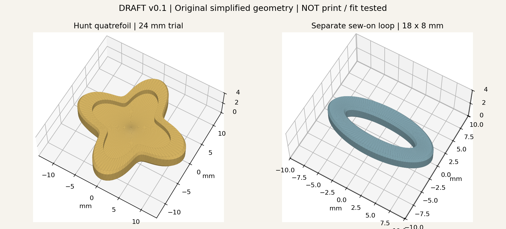

# 巡猎四瓣额饰打印试件 v0.1

已依据巡猎官方角色预览图中可见的金色四瓣额饰，自主建立简化浮雕轮廓。原图的分缝和复杂曲面尚未复刻，厚度、背面与安装结构是制作设计；没有复制官方模型网格。



## 实际文件

| 文件 | 用途 | 当前默认尺寸 mm |
| --- | --- | --- |
| [额饰 STL](hunt-quatrefoil-v0.1-draft.stl) | 四瓣轮廓、凸边、浅凹面，平背 | 24 × 24 × 2.2 |
| [额饰 OpenSCAD](hunt-quatrefoil-v0.1-draft.scad) | 同版网格的可编辑 CAD 文件 | 同上 |
| [缝接底座 STL](sew-on-loop-v0.1-draft.stl) | 独立椭圆穿线环，边缘倒角 | 18 × 8 × 1.6 |
| [底座 OpenSCAD](sew-on-loop-v0.1-draft.scad) | 同版网格的可编辑 CAD 文件 | 同上 |
| [几何检查](geometry-checks.json) | 封闭边、面朝向、尺寸、体积 | 已通过数字检查 |

**全部为未打印、未试装的试件。24 mm 是用来检查比例的设计起点，不是从 38 cm 商品高度换算的适配结果。** STL 本身没有单位字段，导入切片软件时选 mm，核对上述包围盒尺寸。

## 调整与再生成

形状的参数化源文件是 [Python 生成器](../../../../tools/generate_accessories.py)，只生成网格时仅使用 Python 标准库；预览另用 matplotlib。OpenSCAD 文件可直接编辑顶点，也可作为安装结构设计的输入。修改宽度优先重新运行生成器：

```sh
python3 tools/generate_accessories.py --width 24 --height 2.2
# 加 --preview 同步更新 PNG（需要 matplotlib）
```

在仓库根目录执行。宽度改变时底座平面尺寸同比例变化，底座厚度保留 1.6 mm；参数会写入检查记录。文件名保持 v0.1，正式改版应另存版号并登记。

## 试制与安装

1. 先在纸上画 24 mm 四瓣占位，放到娃娃额侧比较大小；据此改宽度。
2. 打印机类型未知，先用现有设备和材料的常用配置打印一件。额饰平背朝下，底座平放；切片后检查薄壁和顶面，按实际设备决定设置。
3. 先将底座穿线环的两端固定到一小段布带上，避免装上额饰后挡住穿线空间。额饰与底座的连接需另做材料相容的粘接小样；该版不是卡扣，尚未做连接强度测试。
4. 将布带系／缝到可拆头饰结构，不要求拆开玩偶头部。检查是否滑动、勾发或压出痕迹。
5. 浅凹面与凸边可以分色涂装；也可只用底座承接缠花。实际材料、重量、上色和安装结果写入制作记录。

模型检查仅验证封闭边、三角面朝向和体积，没有在本机 OpenSCAD／切片器中试切，也没有物理验证。OpenSCAD 导出使用其规定的外视顺时针面序，STL 使用相反面序，依据：[OpenSCAD Primitive Solids](https://files.openscad.org/documentation/manual/Primitive_Solids.html)。
