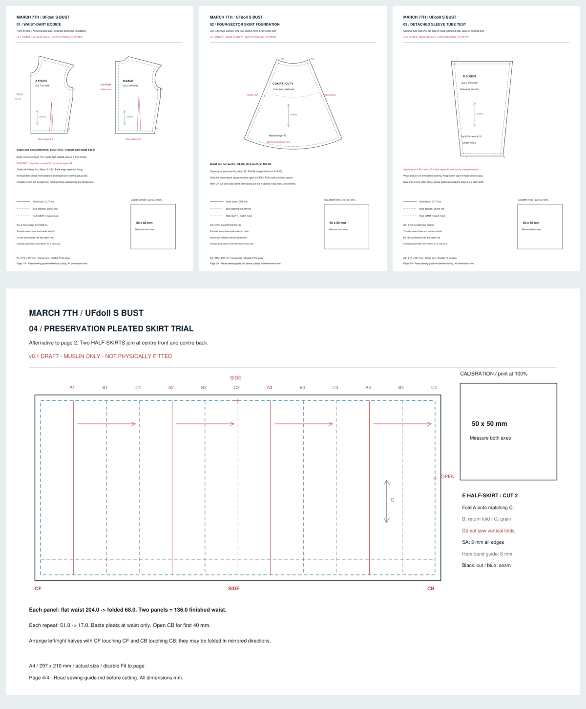

# 纸样

已制作 **v0.1 试坯**：前后腰省衣身、四片半圆裙基础、独立袖筒测试片，以及根据官方模型外观设计的百褶裙试版。它们可按实际大小打印制作试样，尚未实物试穿，也不是完整角色成衣版。

- [A4 PDF，4 页，最后一页横向](muslin-v0.1-draft-a4.pdf)
- SVG：[衣身](muslin-v0.1-draft-page-1.svg)、[基础展摆裙](muslin-v0.1-draft-page-2.svg)、[袖筒](muslin-v0.1-draft-page-3.svg)、[百褶裙试版](muslin-v0.1-draft-page-4.svg)
- [带来源与假设分类的参数](parameters-v0.1.json)
- [缝长与尺寸检查报告](geometry-check-v0.1.json)
- [中文裁剪、缝制与试穿说明](../sewing-guide.md)

当前净胸围 176 mm、闭省后净腰围 136 mm；肩腰长、袖窿深与袖筒臂围等仍使用明确标出的试版假设。先用低成本布料试坯。

预览图用于浏览，请用 PDF 或 SVG 按实际大小打印。百褶裙两半片各展开 204 mm、折后 68 mm；左右半片在前中／后中拼接，后中开口与衣身对齐。两种裙片是替代选项，不同时接到腰上。

- 源文件可采用 SVG、DXF 或实际使用的打版软件格式，导出打印版用 PDF／SVG。
- 统一使用 mm，说明纸张尺寸、拼接方式与 100%／实际大小打印设置。
- 每版必须包含标注边长的校准方框（可采用 50 × 50 mm），打印后用尺核对。
- 裁片标注名称、版号、裁剪数量、左右／镜像、布纹、对位点、折线和开口。
- 写明是否包含缝份，各边缝份分别多少；缝线与裁剪线区分清楚。
- 写明目标娃体、量体表版本、面料条件与实测状态；未试穿文件名加 `draft`。
- 改版保留旧版与 [制作记录](../build-log.md)，记录修改量与原因。

后续改版保持独立版号；不要把当前 `draft` 文件改名为已验证成品而省略试穿。
